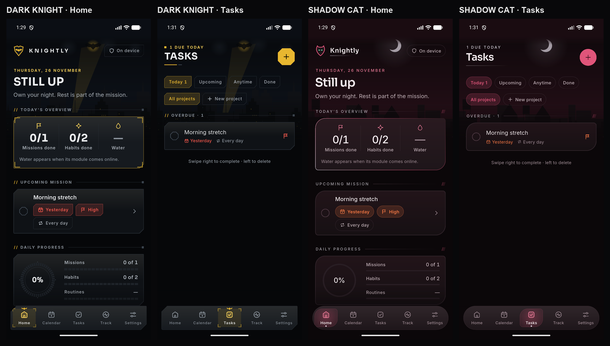

# Knightly — Visual Direction

Knightly ships with two complete themes. Each changes colour, shape language, iconography weight,
motion, progress visuals, the header scene and the brand mark, so the whole app changes character
when you switch.

| | **Dark Knight** | **Shadow Cat** |
|---|---|---|
| Tag | Batman inspired | Catwoman inspired |
| Traits | Tactical · Powerful · Mysterious | Elegant · Stealthy · Fearless |
| Tagline | *Own the night.* | *Move in silence.* |
| Style family | `KStyleFamily.tactical` | `KStyleFamily.feline` |

## Research summary

Both themes start from the shared visual vocabulary of night-time vigilante stories rather than from
any studio's artwork:

- **Film-noir lighting.** Near-black frames, one hard light source, silhouettes against a lit sky.
  This gives the "one light per screen" rule and the near-black canvases.
- **Art-deco and gothic city architecture.** Setback towers, spires and antenna masts give a
  skyline that reads as a dense night city without depicting any real or fictional place.
- **The searchlight in the clouds.** This is the archetypal "call for help" image. Knightly draws its
  own beam and its own bat silhouette in a pool of light.
- **Tactical hardware.** Machined plates with chamfered corners, gold-on-black instrument markings
  and targeting brackets for Dark Knight.
- **Cat-burglar elegance.** Rooftops, chimneys and water towers under a crescent moon, leather and
  rose light, cat-eye (almond) shapes and goggle lenses for Shadow Cat.
- **Modern product UI.** High contrast, a strict type hierarchy and short, purposeful motion. The
  themes should feel premium and calm, not like a costume.

## Design system

### Colour

**Dark Knight:**

| Role | Colour |
|---|---|
| canvas | `#060709` |
| surface | `#0F1216` |
| raised | `#161A1F` |
| overlay | `#1E2329` |
| accent | emblem gold `#E8B730` |
| accent strong | `#F6CD58` |
| secondary detail ("signal") | steel blue `#8FB3D9` |
| danger | `#FF5A4E` |

**Shadow Cat:**

| Role | Colour |
|---|---|
| canvas | plum-black `#0B0709` |
| surface | `#161013` |
| accent | rose `#E0557A` |
| accent strong | `#F27E9C` |
| detail ("signal") | moon silver `#DAD3DE` |
| success | jade `#63D4A6` |
| danger | ember `#FF7A45` |

In Shadow Cat, danger is ember orange so it never reads as the rose accent.

All text roles meet WCAG AA (at least 4.5:1) on every surface. Full palettes:
`lib/core/design/theme/knightly_themes.dart`.

### Shape and ornament (`KnightlyStyle`)

| | Tactical | Feline |
|---|---|---|
| Panels | Chamfered plate (`KChamferBorder`); highlighted panels get corner brackets | Almond: two generous corners, two tight ones |
| Buttons, chips | Cut-corner tabs | Stadium / pill |
| Section headers | `//` prefix, uppercase, rule ending in a square | Tracked uppercase, three claw marks |
| Progress ring | Segmented gauge | Silk arc with a moon-silver tip |
| Progress bar | Cells | Single silk line |
| Nav dock | Chamfered; selected tab marked with brackets and a small winged blade | Stadium; selected tab is an almond with a silver dot |
| Icons | Square caps, mitre joins, heavier stroke (×1.08) | Round caps, lighter stroke (×0.88) |
| Text fields | Underline | Outlined |

### Typography

Sora for display and headlines, Inter for everything else. Tactical uppercases screen titles and the
greeting; feline keeps sentence case. A separate display face per theme was proposed, but it needs
downloading new font files, which has not been approved. Until then both themes use the bundled Sora
and Inter.

## Brand assets

All of these are original geometry drawn in code (`lib/core/design/brand/k_emblems.dart`,
`k_brand_mark.dart`):

- **Bat emblem:** a bat in flight with pointed ears and three scalloped trailing edges on each wing.
  Used in the Dark Knight crest and in the searchlight.
- **Winged blade:** a small bat-wing chevron that marks the selected tab in Dark Knight.
- **Sitting cat:** a cat on a ledge, used in the Shadow Cat header scene.
- **Goggle eyes:** two almond lenses, used in the Shadow Cat crest.
- **Crests:** `KCrestVariant.sentinel` is a shield with the bat. `prowler` is a cat-eared mask
  shield with goggle eyes. `classic` is the original shield and crescent, still used for the launcher
  icon.
- **Header scenes (`KLiveScene`):**
  - Dark Knight: a two-depth skyline with lit windows and a searchlight throwing the bat onto low
    clouds.
  - Shadow Cat: rooftops, a crescent moon and the cat on a ledge.
  - Both are *live*: layers drift in slow parallax (and scroll away with the page), the
    searchlight sways with a light pulse running up the beam, clouds drift, windows flicker; the
    moon's halo breathes and mist drifts between the roofs. Baked bitmaps plus a few shapes at
    30 Hz, paused when not visible. Settings › Systems › Live backdrop turns motion off.

## Motion

| Moment | Tactical | Feline |
|---|---|---|
| Cold start (`KBootSequence`, 1.9 s, tap to skip, skipped under reduce-motion) | Crest scans in behind a gold line; typed status lines; lifts out | Crest fades and scales in; name and tagline rise; fades out |
| Theme switch (820 ms curtain; the theme swaps while hidden) | Shutter wipes down and back up | Iris closes and reopens |
| Page push | Shutter wipe | Fade, scale and rise |
| Tab switch | Incoming tab fades in over 140 ms | Same |
| Nav indicator | Glides 220 ms | Glides 460 ms on a softer curve |
| Checkbox | Path-trim tick inside brackets | Path-trim tick in a circle |

| Page sections | Arrive in a stagger, 45 ms apart: slide in from the left, crisp | Same, rising softly |
| Contextual dock action | Swaps in/out with fade and scale when the screen changes | Same |
| Theme-switch curtain | Bat emblem at the midpoint | Three claw slashes drawn on at the midpoint |

No blur anywhere. The only ambient motion is the live scene, built to the PERFORMANCE.md rules.

## Page worlds

Each tab has its own identity inside the theme's fictional world. Navigation labels stay plain
(Home, Calendar, Tasks, Track, Settings) so the app remains easy to learn.

| Tab | Dark Knight | Shadow Cat | What makes it different |
|---|---|---|---|
| Home | Command centre (wordmark + greeting, no page title) | The hideout (same) | Tall cinematic scene; the next mission is the highlighted "Primary objective" / "Tonight's mark" in large type |
| Tasks | Case files | Targets | One card per mission with a priority colour stripe; Dark Knight shows a case-file number (`#0002`) |
| Track | Console | Instincts | Activity rings (habits today, missions today, habit days this week) plus streaks alive |
| Calendar | Operations | Night plans | Honest "in development" page; the calendar module is a future stage |
| Settings | Gear room | Wardrobe | Theme cards rendered in their own theme ("Suit" / "Look"), "Systems" with Live backdrop |

**Command dock:** solid floating dock, an emblem riding on the selected tab (winged blade / cat
ears), and a contextual command above it that follows the screen: New mission (Home, Tasks),
New habit (Track), none on Calendar and Settings.

## IP limits

The themes are *inspired by* Batman and Catwoman, as the theme tags say openly. They do not
reproduce DC Comics or Warner Bros. property:

- No official logos, including the bat-in-oval emblem or any studio's bat insignia, and no official
  logo animations, film or comic artwork, character likenesses, franchise fonts, music or sound.
- No fictional place names, such as the city's name, in the UI, code or store listing.
- The bat and cat shapes are generic animal silhouettes drawn from scratch.
- The theme tags "Batman inspired" and "Catwoman inspired" name trademarks descriptively.
  **Before any public release, have the tags, theme names and store listing reviewed.** They can be
  changed by editing `KnightlyThemeId.inspiration` without touching anything else.
- The launcher icon stays the neutral classic crest. Android cannot switch launcher icons per theme
  without breaking `flutter run`, because that needs an activity-alias LAUNCHER (ARCHITECTURE D29).
